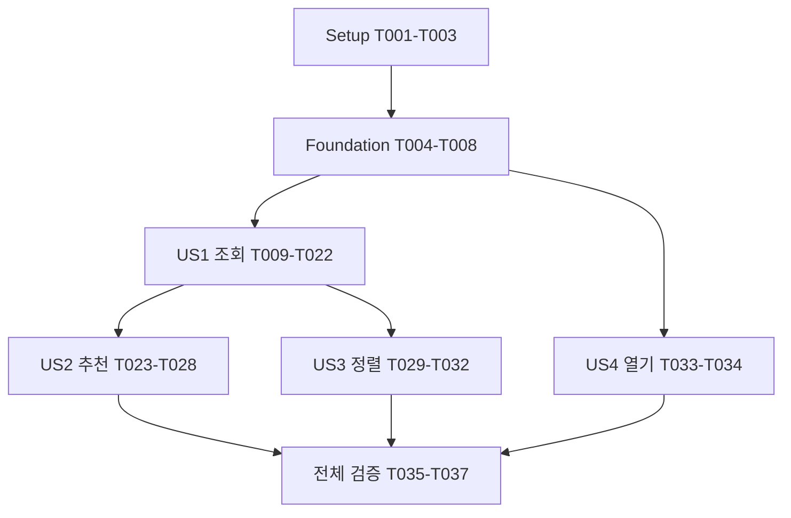

# Tasks: JUNGOL 문제 검색·추천 CLI

**Input**: `specs/001-jungol-problem-picker/`의 설계 문서
**Prerequisites**: [plan.md](plan.md), [spec.md](spec.md), [research.md](research.md),
[data-model.md](data-model.md), [CLI 계약](contracts/cli.md), [조회 계약](contracts/source.md)
**Tests**: spec의 독립 검증·수용 시나리오와 plan/quickstart의 최소 오프라인 검증을 작업에 포함한다.
추가 TDD 승인 절차나 통계 빈도 기반 CI 테스트는 도입하지 않는다.
**Organization**: 공통 기반 → US1 조회 → US2 추천 → US3 정렬 → US4 열기 → 전체 검증.

## Format: `[ID] [P?] [Story] Description`

[P]는 해당 단계의 선행 작업이 완료되었을 때 서로 다른 파일에서 병렬 진행할 수 있는 작업이다.
스토리 작업에만 [US1]~[US4]를 붙인다. 테스트 작업도 구현 전에 작성해 기대 동작의 실패를 확인한다.
테스트 수집·의존성 설치 오류를 기능의 실패 검증으로 대신하지 않는다.

## Path Conventions

경로는 저장소 루트 기준이다. 단일 패키지 `src/algorithm_problem_picker/`,
테스트 `tests/`, 기능 문서 `specs/001-jungol-problem-picker/`를 사용한다.
이 문서는 작업 목록만 생성한다. 아래 소스·테스트·설정 파일은 구현 단계에서 만든다.
로컬 캐싱 제외는 이번 명시적 사용자 지시를 따른다.

## Phase 1: Setup (Shared Infrastructure)

**Purpose**: Python 3.12·uv·jpick의 최소 실행 환경을 준비한다.

- [X] T001 Python 3.12 이상 src 패키지와 jpick 진입점을 `pyproject.toml`, `src/algorithm_problem_picker/__init__.py`에 구성하고 Typer·Rich·Playwright 및 개발 의존성 pytest를 선언한다.
- [X] T002 T001 이후 uv로 의존성을 해결해 `uv.lock`을 생성하고 잠금 설치 및 Chromium 설치가 되는지 확인한다; pytest가 `tests/`와 src 패키지를 찾도록 `pyproject.toml`을 구성한다.
- [X] T003 [P] `.gitignore`에 .venv·Python/pytest 캐시·빌드 산출물을 제외하고 uv.lock은 추적 대상으로 유지한다; 문제 목록이나 브라우저 프로필 저장 경로는 추가하지 않는다.

**Checkpoint**: 의존성을 재현할 수 있고 테스트 실행 환경이 준비된다.

## Phase 2: Foundational (Blocking Prerequisites)

**Purpose**: 스토리가 공유하는 값·입력 조건·결과·공급자 경계를 만든다.
**CRITICAL**: 이 단계를 완료한 뒤 스토리 구현을 시작한다.

- [X] T004 `src/algorithm_problem_picker/models.py`에 문제 요약·Problem과 Known/Unavailable·티어 상태를 정의한다; id는 “양의 정수. 중복 제거와 문제 식별의 유일한 키”, title은 “공백이 아닌 공개 문제 제목”, url은 “정올 HTTPS 문제 URL. 번호와 일치해야 함”, tier는 “1~30인 Rated, 명시적인 Unrated, 확인 불가인 Unavailable 중 하나”, pass_rate는 “Decimal 0~100인 Known 또는 명시적인 미제공인 Unavailable”, solver_count는 “0 이상의 정수인 Known 또는 명시적인 미제공인 Unavailable”, listed_at/details_observed_at은 “시간대 정보가 있는 목록 지표 / 상세 푼 사람 수의 조회 시각”을 그대로 적용한다.
- [X] T005 `src/algorithm_problem_picker/models.py`에 SearchCriteria와 UserReference를 정의한다; 티어 경계는 “각각 생략 또는 1~30. 지정된 하한은 상한 이하여야 함”, 정답률 경계는 “각각 생략 또는 유한 Decimal 0~100”, 인원수 경계는 “각각 생략 또는 0 이상의 정수”, status는 “all / solved / unsolved”, user_handle은 “status가 solved/unsolved일 때 필수. 앞의 @는 한 번 제거하고 대소문자 보존”이다; “모든 경계는 포함한다”와 모든 범위의 하한≤상한을 검증하고 all+user를 거부한다; 사용자는 “정확한 공개 handle과 정올 숫자 account_id, resolved_at으로 구성한다”를 따른다.
- [X] T006 `src/algorithm_problem_picker/models.py`에 CompletedListing·Result·진행 상태를 정의한다; “같은 ID가 다시 나오면 최초 레코드를 유지한다”, “전체 목록이 정상 종료된 후에만 CompletedListing으로 전환한다”, “결과는 완전 조회 성공일 때만 생성한다. 후보 부족과 0개는 정상 결과다”를 적용하고 조건·기준 사용자·문제·조회/적격/미제공 제외 개수·시작/완료 시각·요청/반환 개수·부족 개수를 담는다; Complete 이전에는 Presented로 전환할 수 없게 한다.
- [X] T007 T004~T006 이후 `src/algorithm_problem_picker/ports.py`에 resolve_user·collect·read_details의 단일 공급자 Protocol과 사용자 확인·접근·DOM 구조·완전성 실패의 오류 경계를 정의한다; 브라우저 구현을 도메인으로 노출하거나 테스트 전용 공개 API를 추가하지 않는다.
- [X] T008 `src/algorithm_problem_picker/cli.py`에 Typer 루트와 --help·--version을 구현하고 버전은 패키지 메타데이터에서 읽는다; 명령 조립 위치를 정하되 import나 도움말 실행만으로 Playwright·네트워크·기본 브라우저를 시작하지 않는다.

**Checkpoint**: 명세의 값과 경계를 공유하며 `uv run jpick --help`가 원격 접근 없이 동작한다.

## Phase 3: User Story 1 - 조건에 맞는 문제 조회 (Priority: P1) 🎯 MVP

**Goal**: 모든 페이지에서 난이도·정답률·푼 사람 수·지정 사용자 풀이 조건을 적용해 기본 번호순으로 조회한다.
**Independent Test**: 경계·미정·오답만 있는 사용자와 두 페이지를 갖춘 고정 데이터에서
모든 결과가 조건을 만족하고, 전체 후보 기준으로 표시 개수 제한을 적용하는지 검증한다.

### Tests for User Story 1

- [X] T009 [P] [US1] `tests/test_selection.py`에 포함 경계의 복합 필터, Decimal 소수 경계, 생략한 경계, Known(0)·Unrated·Unavailable 및 기본 번호순/표시 제한 검증을 작성한다; 지표 미제공 제외 개수도 확인한다.
- [X] T010 [P] [US1] `tests/fixtures/jungol/list.html`, `detail.html`, `pagination.html`, `user.html`, `empty.html`, `error.html`에 최소 로컬 DOM을 구성한다; 서로 다른 정답 제출/전체 제출/맞힌 사람 수, 티어·미정·미제공, 두 페이지·커서 추가 로드·로딩·반복·종료, 정확한 핸들·없음·모호함을 재현하고 실제 계정 목록이나 사이트 전체를 저장하지 않는다.
- [X] T011 [P] [US1] `tests/test_service.py`에 고정 공급자로 전체 후보 수집·ID 중복 제거·최초 레코드 유지, cheap 필터 뒤 필요한 상세만 조회, 상세 보강 시 목록 티어·정답률 보존, all/solved/unsolved 분할과 오답만 있는 문제의 unsolved 포함, 중간 실패 시 최종 결과 금지를 검증한다.
- [X] T012 [P] [US1] `tests/test_cli.py`에 list 기본 limit=20·공통 필터·양의 정수 개수·NaN/Infinity 및 역전 범위·사용자 누락/all+user 오류를 검증한다; 입력 오류는 브라우저 시작 전 코드 2, 원격/사용자 실패는 1, Ctrl+C는 130, 정상 빈 결과는 0이며 stdout 결과·stderr 진행/진단과 기본 브라우저 미호출도 확인한다.
- [X] T013 [P] [US1] T010 이후 `tests/test_jungol_dom.py`에서 로컬 fixture와 차단된 원격 요청으로 실제 DOM 로케이터를 검증한다; 티어·퍼센트·맞힌 사람 구분, 사용자 정확 일치와 풀이 조건 적용, 다음 페이지/커서 종료·중복·진행 없음, 일시 빈 DOM과 정상 빈 결과, 상세 ID 불일치·구조 변경·403/429·챌린지·로그인 요구·타임아웃 및 context/browser 정리를 확인한다.

### Implementation for User Story 1

- [X] T014 [US1] `src/algorithm_problem_picker/jungol.py`에 동기 Playwright 공급자 수명을 구현한다; 숨겨진 비영구 context 한 개와 목록/상세 페이지 두 개, 한국어·1280×900, 탐색 30초/DOM 15초, 탐색·추가 로드 시작 간격 최소 1초를 적용하고 성공·실패·Ctrl+C 모두 닫는다; 자동 재시도·영구 프로필·상태 파일·내부 API 호출은 추가하지 않는다.
- [X] T015 [US1] `src/algorithm_problem_picker/jungol.py`에 공개 사용자 선택 UI의 정확한 핸들 해석을 구현한다; 첫 유사 검색 결과를 임의 선택하지 않고 계정 없음/모호함을 오류로 처리하며 확인된 숫자 ID에 solvedByMode=include/exclude를 적용한다; 로그인 사용자용 status 조건을 사용하지 않는다.
- [X] T016 [US1] `src/algorithm_problem_picker/jungol.py`에 일반 문제(type=problem)·번호 오름차순·안전한 티어/풀이 URL 조건과 적용 확인을 구현한다; 범위가 없으면 unrated=include를 유지하고 행의 제목/문제 링크·티어 배지·정답률을 의미 있는 DOM에서 읽는다; 퍼센트는 Decimal로 읽고 알 수 없는 구조를 미확인 값으로 바꾸지 않는다.
- [X] T017 [US1] `src/algorithm_problem_picker/jungol.py`에 실제 다음 링크 및 더 불러오기 기반 전체 목록 수집을 구현한다; 로딩 완료와 새 ID/종료/오류를 구분하고 최초 관측 ID 레코드를 유지하며, 반복 페이지·진행 없음·필터 미적용을 실패로 전파한다; 정상 종료 이전에는 CompletedListing을 반환하지 않는다.
- [X] T018 [US1] `src/algorithm_problem_picker/jungol.py`에 후보와 상세 ID 일치 확인 및 title='맞힌 사람' 통계 추출을 구현한다; 쉼표를 제거한 푼 사람 수와 상세 조회 시각만 보강하고 목록 티어·정답률을 덮어쓰지 않으며, 제출 수 대체·직렬화된 앱 상태 추출을 하지 않는다.
- [X] T019 [P] [US1] `src/algorithm_problem_picker/selection.py`에 순수 복합 필터와 기본 ID 오름차순 처리를 구현한다; 티어 범위가 있으면 Unrated/Unavailable을 제외하고, 해당 지표 필터의 미제공 값은 제외 개수로 집계하며 미지정 지표의 미확인은 유지한다; 모든 경계를 포함하고 표시 제한은 최종 후보에만 적용한다.
- [X] T020 [US1] T014~T019 이후 `src/algorithm_problem_picker/service.py`에 입력 검증된 조건 → 필요 시 사용자 해석 → 전체 목록 수집 → 티어/정답률 필터 → 잔여 후보 상세 → 인원수 필터 → 완전한 Result 흐름을 구현한다; 진행 개수·조회 시각·미제공 제외 개수를 전파하고 모든 단계 실패/취소를 빈 결과나 일부 성공으로 바꾸지 않는다.
- [X] T021 [US1] `src/algorithm_problem_picker/cli.py`에 list 공통 필터·기본 번호순·limit=20과 Rich 표/요약을 연결한다; 번호·제목·난이도·정답률·푼 사람 수·링크·기준 사용자/조건·적격/표시 개수·조회 시각을 출력하고 stderr 진행·Ctrl+C 안내·오류 원인 및 0/1/2/130 종료 계약을 적용한다.
- [X] T022 [US1] `tests/test_selection.py`, `tests/test_service.py`, `tests/test_jungol_dom.py`, `tests/test_cli.py`의 US1 검증을 실행해 모두 통과시킨다; 네트워크 없는 검증과 실제 동작의 실패/빈 결과 구분을 확인하고 통과하지 않은 작업을 완료 처리하지 않는다.

**Checkpoint**: US1만으로 조건에 맞는 문제 조회가 동작하며 추천·추가 정렬·열기 없이 독립 검증할 수 있다.

## Phase 4: User Story 2 - 중복 없는 무작위 추천 (Priority: P1)

**Goal**: US1과 같은 필터를 적용한 전체 적격 후보에서 원하는 수를 중복 없이 추천한다.
**Independent Test**: 두 페이지의 고유 적격 후보 12개에서 5개를 요청해 개수·조건·중복·
전체 후보 전달을 확인하고, 후보 부족·0개·수집 실패를 구분한다.

### Tests for User Story 2

- [X] T023 [P] [US2] `tests/test_selection.py`에 표준 sample의 입력이 전체 고유 적격 후보이며 k=min(요청,후보)인지 검증하고 12개 중 5개·후보 부족·0개·중복 입력 사례를 추가한다; 반복 빈도나 매번 다른 결과를 필수 조건으로 삼지 않는다.
- [X] T024 [P] [US2] `tests/test_service.py`에 두 번째 페이지 후보 포함·조회와 추천의 동일 필터 의미·추천 전 전체 상세 보강 완료 및 중간 실패 시 sample 미호출을 검증한다; 원격 접근 없는 공급자 대체를 사용한다.
- [X] T025 [P] [US2] `tests/test_cli.py`에 recommend 기본 count=1·양의 정수 검증·요청/실제/부족 개수 안내와 빈 결과 0/실패 1/취소 130을 검증하고, 조회용 Chromium 외의 기본 브라우저는 호출하지 않는지 확인한다.

### Implementation for User Story 2

- [X] T026 [US2] `src/algorithm_problem_picker/selection.py`에 완료된 고유 후보에서 random.sample을 한 번 호출하는 비복원 추천을 구현한다; 요청/반환 개수·부족 개수를 계산하고 추출 순서로 반환한다.
- [X] T027 [US2] `src/algorithm_problem_picker/service.py`에 US1의 완전한 후보 생성 흐름을 재사용하는 추천 유스케이스를 구현한다; 기본 list 표시 제한을 추천 후보에 적용하지 않고 완료 전에 추첨하지 않는다.
- [X] T028 [US2] `src/algorithm_problem_picker/cli.py`에 recommend와 --count를 연결하고 동일 필터·공통 출력·부족 안내·종료 코드를 적용한다; T023~T025의 추천 검증을 통과시킨다.

**Checkpoint**: US2는 자체 명령과 고정 공급자로 검증되며, 지표 정렬·브라우저 열기 구현에 의존하지 않는다.

## Phase 5: User Story 3 - 원하는 순서로 조회 (Priority: P2)

**Goal**: 전체 적격 후보를 지표별 양방향 또는 무작위로 정렬한 다음 표시 개수를 제한한다.
**Independent Test**: 동점·미정·미확인과 두 페이지 후보를 포함한 목록으로
여섯 가지 지표 정렬 및 무작위 순서의 누락·중복 없음과 limit 후적용을 확인한다.

### Tests for User Story 3

- [X] T029 [P] [US3] `tests/test_selection.py`에 난이도/정답률/푼 사람 수 양방향, 기본 ID 양방향, 동점 ID 오름차순, 미정·미확인 마지막, 전체 후보 정렬 후 limit과 shuffle의 누락/중복 없음을 검증한다.
- [X] T030 [P] [US3] `tests/test_cli.py`에 --sort id/difficulty/rate/solvers/random 및 --order asc/desc 전달, 기본값 유지와 random+desc 입력 오류를 검증하고, 정렬 때문에 서버에서 미정 문제가 누락되지 않는 서비스 결과를 사용한다.

### Implementation for User Story 3

- [X] T031 [US3] `src/algorithm_problem_picker/selection.py`에 지표 양방향·ID 동점·미확인 마지막 정렬과 전체 후보 shuffle을 구현하고 필요한 정렬 값 정의를 `src/algorithm_problem_picker/models.py`에 추가한다; 서버 난이도 정렬을 사용하지 않는다.
- [X] T032 [US3] `src/algorithm_problem_picker/service.py`와 `src/algorithm_problem_picker/cli.py`에 list 정렬 옵션을 연결하고 전체 정렬 뒤 limit을 적용한다; T029~T030과 기존 조회·추천 테스트를 통과시켜 표시 제한이 추천에 섞이지 않음을 확인한다.

**Checkpoint**: US3는 list 명령으로 검증되며 US2 추천과 별도로 사용할 수 있다.

## Phase 6: User Story 4 - 선택한 문제 열기 (Priority: P2)

**Goal**: 명시적으로 지정한 문제만 기본 브라우저에 한 번씩 전달한다.
**Independent Test**: 브라우저 호출을 대체해 1000·1000·1001 입력이 1000·1001 각각
한 번의 호출이 되는지, 일부/전체 실패 시 링크와 실패 코드를 반환하는지 확인한다.

### Tests for User Story 4

- [X] T033 [US4] `tests/test_cli.py`에 open의 양의 정수 인자·한 개 이상·입력 순서 유지 중복 제거, 기본 브라우저 전달 성공/부분 실패/전체 실패와 링크 출력·종료 코드를 검증한다; open이 정올 조회나 Chromium을 시작하지 않고 list/recommend도 기본 브라우저를 열지 않는지 확인한다.

### Implementation for User Story 4

- [X] T034 [US4] `src/algorithm_problem_picker/cli.py`에 open ID [ID ...]를 구현한다; 고유 번호의 정올 HTTPS 링크를 표준 webbrowser로 각각 한 번 전달하고 실패 시 모든 요청 링크·실패 번호와 코드 1을 반환하며, 이미 열린 탭은 다시 열지 않는다; T033을 통과시킨다.

**Checkpoint**: US4는 원격 데이터 조회 없이 독립적으로 동작하며 네 스토리가 모두 준비된다.

## Phase 7: Polish & Cross-Cutting Concerns

**Purpose**: 사용법을 최종 구현에 맞추고 전체 명세의 검증 결과를 남긴다.

- [X] T035 [P] `README.md`를 실제 설치·jpick 명령·티어/정답률/인원수/공개 사용자 필터 예시·진행/취소·종료 코드·비영구 처리·사이트 관측 한계에 맞게 갱신한다; 기존 로컬 캐싱 기획은 이번 구현 범위에서 제외했음을 명시하고 공개 API 지원을 확보했다고 주장하지 않는다.
- [X] T036 [P] 전체 `tests/`를 오프라인으로 실행하고 준비된 10,000개 후보의 로컬 필터·정렬·추첨 시간을 측정해 `specs/001-jungol-problem-picker/quickstart.md`에 명령·환경·실제 결과를 기록한다; 영구 문제/사용자/브라우저 상태 저장이 없는지 `src/algorithm_problem_picker/`를 검토하고 네트워크 시간을 로컬 1초 목표와 섞지 않는다.
- [X] T037 T036 이후 `specs/001-jungol-problem-picker/quickstart.md`의 제한된 라이브 조회·추천·동일 후보 범위 all/solved/unsolved 비교·명시적 열기·Ctrl+C 검증을 수행하고 결과를 기록한다; 통계·사용자 상태는 같은 시점의 화면과 비교하고 접근 제한 시 중단한다; 실행하지 못한 항목은 성공으로 표시하거나 작업을 완료 처리하지 않고 외부 조건과 남은 검증을 기록한다.

**Checkpoint**: 오프라인 검증과 실제 수행한 라이브 검증의 결과·한계를 구분해 확인할 수 있다.

## Dependencies & Execution Order

### Phase Dependencies

- Setup의 T001 → T002는 순차다. T003은 별도 파일이므로 T001 또는 T002와 병렬 가능하다.
- Foundational의 T004 → T005 → T006 → T007 → T008은 순차다.
  models.py를 여러 작업이 수정하므로 병렬 실행하지 않는다.
- US1의 테스트 준비 후 T014~T018은 같은 jungol.py에서 순차 진행한다.
  selection.py의 T019는 해당 테스트 작성 후 T014~T018과 병렬 진행할 수 있다.
- T020은 공급자·필터 구현 완료에, T021은 T020에, T022는 US1 전체 구현에 의존한다.
- US2와 US3는 US1의 완전한 후보 생성이 필요하다. 서로의 기능에는 의존하지 않지만
  selection.py·service.py·cli.py와 같은 테스트 파일을 공유하므로 기본 진행은 US2 → US3로 한다.
- US4의 논리적 선행 조건은 공통 기반뿐이다. 공통 cli.py/test_cli.py를 수정하는
  다른 스토리 작업과 동시에 편집하지 않는다. 기본 실행 순서는 P1 → P2 순서를 따른다.
- 최종 검증은 네 스토리 완료 후 진행한다. T035와 T036은 서로 다른 파일 작업이고,
  T037은 같은 quickstart.md에 기록하므로 T036 다음에 실행한다.

### User Story Dependencies

화살표는 기능 의존성이다. 같은 파일 편집을 피하기 위한 순차 진행도 별도로 적용한다.
US2·US3는 고정 공급자를 사용해 각각의 명령/동작을 독립적으로 검증한다.

### Within Each User Story

테스트 작성과 기대 동작 실패 확인 → 구현 → 테스트 통과 → 스토리 체크포인트 순서다.
사이트 접근·DOM 파싱 오류를 테스트 통과를 위한 fallback이나 빈 값으로 숨기지 않는다.
중간 단계에서 추천·정렬을 앞당겨 일부 후보를 정상 결과로 반환하지 않는다.

### Parallel Opportunities

[P]는 실제 병렬 실행 지시나 에이전트 실행을 뜻하지 않는다.
동일 파일을 수정하는 작업은 다른 스토리라도 동시에 진행하지 않는다.
선행 작업이 완료된 범위에서만 아래 예시를 적용한다.

## Parallel Example: User Story 1

공통 기반 완료 후 T009(selection 테스트), T010(HTML fixture),
T011(service 테스트), T012(CLI 테스트)는 파일이 달라 병렬로 작성할 수 있다.
T013(DOM 테스트)은 T010 완료 후 실행한다.
테스트 준비 후 T014~T018(jungol.py)과 T019(selection.py)를 나누어 진행하고 T020에서 통합한다.

## Parallel Example: User Story 2

US1 완료 후 T023(selection 테스트), T024(service 테스트), T025(CLI 테스트)는 병렬 작성 가능하다.
구현 T026 → T027 → T028은 기능 의존성과 통합 순서에 따라 순차 진행한다.

## Parallel Example: User Story 3

US1 완료와 공유 파일의 이전 변경 통합 후 T029(selection 테스트)와 T030(CLI 테스트)는
병렬 작성 가능하다. T031 → T032는 순차 진행한다.

## Parallel Example: User Story 4

스토리 내부에는 안전하게 병렬화할 작업이 없다. T033 → T034로 진행한다.
공통 기반 후 다른 작업자가 jungol.py의 T014~T018을 진행하는 동안
US4를 수행할 수 있지만 cli.py/test_cli.py 변경이 시작되기 전에 통합해야 한다.

## Implementation Strategy

### MVP First (User Story 1 Only)

T001~T022로 공통 기반과 US1을 완성하고 독립 검증한다.
이 MVP는 복합 조건과 공개 사용자 풀이 필터가 있는 기본 번호순 조회다.
전체 목표에는 US2~US4도 포함되므로 MVP 완료만으로 이번 기능 전체를 완료했다고 보고하지 않는다.

### Incremental Delivery

US1 조회 → US2 추천 → US3 추가 정렬 → US4 열기 순서로 기능을 추가한다.
각 단계에서 기존 테스트를 유지하고 마지막에 T035~T037로 실제 사용 가이드를 검증한다.
추천은 US3의 추가 정렬과 무관하게 전체 적격 후보를 사용한다.

### Parallel Team Strategy

동시 작업이 필요하면 위 예시처럼 서로 다른 파일만 분담한다.
공유 모델·공급자·CLI에 대한 동시 편집보다 명시적인 통합 순서를 우선한다.

## Notes

- 총 37개: 공통 8개, US1 14개, US2 6개, US3 4개, US4 2개, 마무리 3개.
- 기능 추적: FR-001~006 → T004~T007·T009~T021, FR-007 → T029~T032,
  FR-008 → T011·T017~T024·T032, FR-009~010 → T023~T028,
  FR-011 → T012·T025·T033~T034, FR-012~013 → T009~T022·T024~T025,
  FR-014~015 → T014~T018·T035~T037, FR-016 → T006·T012·T020~T021·T037.
- 성과 추적: SC-001 → T009~T022, SC-002 → T029~T032, SC-003 → T023~T028,
  SC-004 → T011·T013·T023~T024·T029, SC-005 → T028·T034~T037,
  SC-006 → T012~T018·T022·T025·T033·T037.
- 설치·테스트·라이브 검증은 구현 단계의 작업이다. 이 문서 작성으로 실행 완료를 주장하지 않는다.
- 영구 캐시·로그인·JSON/파일 출력·타 플랫폼·내부 API 구현 작업은 추가하지 않는다.

## Phase 8: Convergence

- [X] T038 [HIGH] `src/algorithm_problem_picker/jungol.py`의 `_wait_listing`·`_collect`에서 추가 로드 버튼이 일시적으로 사라졌다는 이유로 수집을 완료하지 않도록 수정한다; 현재는 버튼 제거 후 400ms 뒤 새 행이 생기는 로컬 DOM에서 실제 후보 4개 중 3개만 담은 CompletedListing을 반환한다(F1). 공개 DOM의 로딩 상태·요청 완료·새 ID·정상 종료를 함께 확인하고 완료를 입증할 수 없는 상태는 완전성 실패로 처리한다; `tests/test_jungol_dom.py`에 지연된 행/버튼 갱신 및 진행 없음 회귀 검증을 추가하고 `tests/test_service.py`에서 전체 후보 확인 전 정렬·추천·결과 반환이 없음을 확인한다 per FR-008, FR-009, FR-013, US1/AC3, US2/AC1, T013, T017 (partial)
- [X] T039 [HIGH] `src/algorithm_problem_picker/jungol.py`의 `read_details`에서 통계 요소의 존재만으로 값을 확정하지 말고 해당 상세의 로딩·관련 요청과 통계 준비 완료를 확인한 뒤 푼 사람 수와 관측 시각을 반환하도록 수정한다; 현재는 aria-busy=true인 상세의 임시 0을 Known(0)으로 반환하고 400ms 뒤 표시되는 실제 5,171을 놓친다(F2). 로딩 중 빈 값도 Unavailable로 확정하지 않으며 접근·구조·시간 초과는 실패로 전파하고 목록 티어·정답률은 보존한다; `tests/test_jungol_dom.py`와 `tests/test_service.py`에 지연된 통계 갱신·로딩 중 빈 값·실제 0/명시적 미제공·최종 푼 사람 수 필터 검증을 추가한다 per FR-002, FR-005, FR-012, SC-001, T013, T018, T020 (partial)
- [X] T040 [HIGH] `src/algorithm_problem_picker/jungol.py`의 `resolve_user`·`_wait_user_page`에서 검색어 입력 직후 이전 결과를 현재 검색 결과로 판정하지 않도록 수정한다; 현재는 @Other가 남아 있고 400ms 뒤 @Sample로 바뀌는 로컬 사용자 UI에서 정확한 Sample 검색을 사용자 없음으로 종료한다(F3). 현재 검색어에 대한 공개 UI 갱신 완료를 확인한 뒤 전체 결과의 정확한 핸들·없음·모호함을 판정하고, 같은 핸들 목록이 유지되는 정상 갱신과 지연된 페이지 전환도 구분한다; 고정 대기시간 증가로 대체하지 말고 `tests/test_jungol_dom.py`에 최초 검색의 이전 결과·지연된 정확 일치/빈 결과·동일 핸들 목록 갱신 회귀 검증을 추가한다 per FR-003, FR-004, FR-012, US1/AC2, T013, T015 (partial)

## Phase 9: Convergence

추가 검토에서 발견한 지연 진행 컨트롤·중간 사용자 DOM 변경도 T041·T042 범위에서 보완했다. 완료 근거와 최신 회귀 결과는 [quickstart의 추가 보완 기록](quickstart.md#추가-검토-보완-t041t042-2026-10-21)을 따른다.

- [X] T041 [HIGH] `src/algorithm_problem_picker/jungol.py`의 `_wait_listing`·`_collect`에서 추가 로드 요청의 전송 완료를 목록 DOM 반영 및 최종 종료의 증거로 사용하지 않도록 보완한다; 현재는 버튼 클릭 → 로컬 fetch 응답 완료 → 버튼 제거 → 400ms 뒤 새 행 추가 순서에서 실제 후보 4개 중 3개만 담은 CompletedListing을 반환한다(F1). 해당 로드의 공개 결과 DOM 반영과 새 ID 또는 정상 종료를 확인하고, 완료를 입증할 수 없으면 완전성 오류로 종료한다; 고정 대기시간 증가는 해결책으로 삼지 않는다. `tests/test_jungol_dom.py`에 응답 완료 후 지연된 행/진행 컨트롤 반영과 빈 최종 로드의 완료 근거 검증을 추가하고, `tests/test_service.py`에서 누락된 후보로 정렬·추천·성공 결과를 반환하지 않음을 검증한다 per FR-008, FR-009, FR-013, US1/AC3, US2/AC1, T013, T017, T038 (partial)
- [X] T042 [HIGH] `src/algorithm_problem_picker/jungol.py`의 `_update_user_page`·`_wait_user_page`에서 요청 완료 카운터만으로 현재 검색 결과의 DOM 갱신을 확정하지 않도록 보완한다; 현재는 이전 @Other가 남아 있는 UI에서 검색 요청 응답 완료 후 400ms 뒤 @Sample을 반영하면 정확한 Sample 검색을 사용자 없음으로 종료한다(F2). 현재 검색어/페이지에 대한 결과 반영 완료를 확인한 뒤 정확 일치·없음·모호함을 판정하고, 동일 핸들 목록이 유지되는 정상 갱신도 지원하되 완료 근거가 없으면 사용자 확인 실패로 처리한다; 고정 대기시간 증가는 해결책으로 삼지 않는다. `tests/test_jungol_dom.py`에 요청 완료와 DOM 반영이 분리된 최초 검색·페이지 전환·빈 결과·동일 핸들 결과의 회귀 검증을 추가한다 per FR-003, FR-004, FR-012, US1/AC2, T013, T015, T040 (partial)
